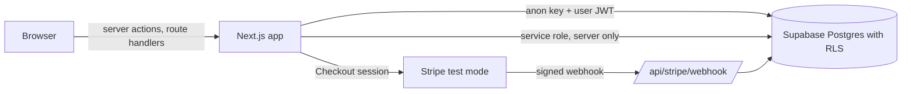

# Security review of an AI-built Next.js, Supabase, Stripe app

> **Warning.** The tag `v0-as-shipped` is deliberately insecure. It holds ten seeded flaws so the exploit tests have something to find. Never deploy it, and never point it at real data. Only `main` is meant to run anywhere.

This is a work sample on synthetic data. It shows how I review an app that was put together quickly with AI coding tools, before real customer and card data goes in.

## The problem

> Our B2B ordering app was built with Claude Code over several months. It works and customers use it, but the backend grew fast and nobody senior has reviewed it. Before real card and customer data goes in, we need an independent senior engineer to review the code, give us a written report ranked by severity, and then help with the cleanup.

## What this sample shows

- **The app.** Cedar Supply Portal is a small multi-tenant ordering app: organization sign-up, product list, cart, Stripe Checkout, order history, invoice download, an admin page and an import-from-URL feature.
- **The old code.** The tag `v0-as-shipped` is the app as a fast AI-assisted build might ship it, with ten seeded flaws (F01 to F10).
- **The proof.** Each flaw has an exploit test in `tests/exploits/`. It fails on `v0-as-shipped` and passes on `main`. The CI jobs `exploits-v0` and `exploits-main` check both directions on every push, so a flaw that returns breaks the build.
- **The fixes.** One commit per finding, so you can read each change on its own. They are on the build branch, `sample/01-ai-app-security-review`, and the commit ids in the report refer to it. `main` holds the same code as one squashed commit.
- **The report.** [`docs/findings/REPORT.md`](docs/findings/REPORT.md) ranks the findings by severity. Each one has the file and line at v0, the test that reproduces it, the fix commit, the retest result and a note in plain words. It ends with a 30-day cleanup plan and a list of what I left unfixed.

| ID | Finding | Severity |
|---|---|---|
| F01 | Row level security off on `orders` | High |
| F02 | Service role key imported into a client component | High |
| F03 | Stripe webhook accepts unsigned events | High |
| F05 | Price taken from the browser | High |
| F07 | Import from URL reaches internal addresses (SSRF) | High |
| F04 | Webhook not idempotent, replay fulfills twice | Medium |
| F06 | Invoice download without an ownership check (IDOR) | Medium |
| F08 | Stored script injection through product notes | Medium |
| F09 | Errors return stack traces and SQL | Low |
| F10 | No security headers | Low |

## Architecture



The trust boundaries and where each finding lives are in [`docs/architecture.md`](docs/architecture.md).

## Quick start

You need Docker, Node.js 22, make and git.

```
make demo
```

That starts Supabase locally, seeds the data, starts stripe-mock and the app, then opens `http://localhost:3000` and the rendered report. Sign in as `admin.harbor@example.com` with the password `demo-password-1`. Other accounts follow the pattern `buyer1.birchwood@example.com` and `buyer2.northside@example.com`.

To run everything the way CI does:

```
make audit
```

That runs Semgrep, gitleaks and osv-scanner, then both exploit suites (the old tag in a temporary checkout, then `main`), and writes `docs/findings/REPORT.html`. It resets your local Supabase database twice and nothing else.

Stripe runs against stripe-mock, so no Stripe account is needed. stripe-mock never sends webhooks. The smoke test plays Stripe's part by signing an event with the local secret.

## Tests and coverage

| Command | What it runs |
|---|---|
| `make unit` | Types, lint, and unit tests with an 80% line coverage gate on `lib/` and the server actions |
| `make pgtap` | Database policy tests (`supabase test db`) |
| `make exploits` | The ten exploit tests against `main`, expecting every one to pass |
| `make e2e` | Playwright smoke test: sign up, add to cart, check out against stripe-mock, see the paid order |
| `make test` | All of the above |

The numbers (unit tests passed, line coverage, exploit results, ZAP summary) are printed in each CI run's job summary and uploaded as artifacts. I do not copy them here by hand, because they would go stale.

The exploit suite shows that each fix holds and that a flaw coming back is caught. It does not show that I could find an unknown flaw in your app. Finding those is what the first week of an engagement is for.

A note on how the exploit suite stays honest. A test only counts as a detection if it fails on an assertion. If the app, the database or the browser is not running, the run is marked invalid instead. The assertions check that the safe condition is present, for example that a correlation id is returned, and not only that the unsafe one is absent.

## Design decisions

- **The database enforces tenancy.** Row level security is the rule, and the app's own filters are a second layer. F01 shows what happens when only the app filters.
- **One transaction for fulfillment.** A Postgres function records the event id and fulfills the order together. A crash between the two cannot lose an order or duplicate one.
- **A guarded connection for outbound fetches.** The import feature checks the address when it connects, not only when it parses the URL, so a name that resolves to a private address is refused too.
- **Exploit tests drive the real thing.** HTTP calls, a real database and a real browser for the two cases that need one.
- **The content security policy still allows inline scripts.** Next.js needs them until the app moves to nonces. It is listed as unfinished in the report.
- **Tool versions are pinned.** Node.js is pinned to major version 22, and everything else below is pinned exactly, in `package.json` and its lockfile or in the CI workflow and `docker-compose.yml`: TypeScript 5.9.3, Next.js 16.3.8, React 19.3.0, `@supabase/supabase-js` 2.117.2, `@supabase/ssr` 0.12.7, Stripe Node library 23.0.0, zod 4.6.5, undici 8.11.2, Vitest 5.0.3, Playwright 1.63.0, Supabase CLI 2.119.0, mermaid-cli 12.0.0, Semgrep 1.179.0, gitleaks 8.30.1, osv-scanner 2.6.0, OWASP ZAP 2.17.0, stripe-mock 0.206.0. The Python packages used for the images and the PDF (Pillow and Markdown) are not version-pinned.

## What this sample does not do

- It is not a penetration test, and it is not a certification of anything.
- It does not use real client, employer or personal data.
- It does not cover load testing, mobile clients, the hosting platform, or social engineering.
- The ten flaws were seeded, so the count says nothing about how many an app like this would really have.
- Several items are left open on purpose and listed in the report, among them the inline-script allowance in the content security policy, rate limiting, and the cross-origin headers.
- It is not deployed. Never deploy `v0-as-shipped`.

## Data sources and licenses

All data is synthetic and generated by `scripts/seed.ts`. See [`data/SOURCES.md`](data/SOURCES.md). The code is licensed MIT OR Apache-2.0 (`LICENSE-MIT`, `LICENSE-APACHE`).

Kunjar Bhaduri. I lead and deliver the work myself, using frontier AI tooling to move fast.
