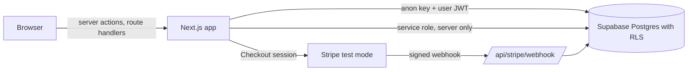

# Architecture

Cedar Supply Portal is a small multi-tenant ordering app. Each customer is an organization, and a person belongs to exactly one.

## Trust boundaries

- **Browser to server.** Everything the browser sends is untrusted: prices, ids, URLs, note text. The server validates it and decides.
- **Server to database, as the user.** Most reads and writes use the caller's own token, so row level security applies. This is the default path.
- **Server to database, as the service role.** Used only where no user is present (the webhook, account creation) or where an admin action has already checked the role. The module is marked `server-only`, so a client component cannot import it.
- **Stripe to server.** Events are trusted only after the signature check on the raw body, and each event id is processed once.
- **Server to the outside.** The import feature calls out to approved hosts only, over https, and refuses private addresses at connection time.

## Where each finding lives

| Place | Findings |
|---|---|
| Database | F01 row level security on orders |
| Browser bundle | F02 service role key, F08 product notes |
| Webhook | F03 signature check, F04 once-only processing |
| Checkout route | F05 server-side pricing |
| Invoice action | F06 ownership check |
| Import route | F07 host allowlist and address checks |
| Every route | F09 generic errors with a correlation id, F10 security headers |

## Data model

`orgs`, `profiles` (user to organization and role), `products` (shared catalog with a Stripe Price id), `product_notes`, `orders`, `order_items`, `invoices`, `shipments`, and, after F04, `processed_events`. The migrations in `supabase/migrations` are the source of truth. The old schema is the first file, and each fix that needs a database change adds its own file.
